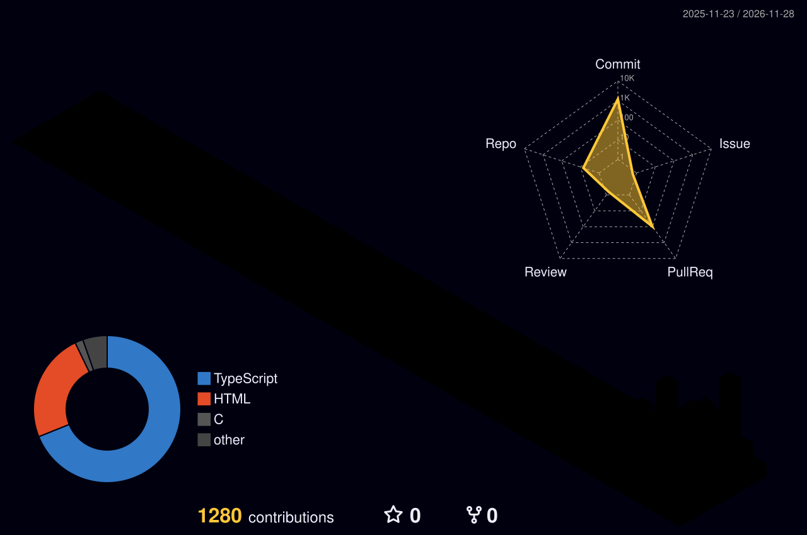

  

  

# Leonardo Alves

> [!NOTE]
> **Open to work:** paid curricular internship, 680 hours, starting **February 2027**.
> On-site near Oliveira de Azeméis, or hybrid/remote across the Aveiro, Porto and Coimbra districts.

## At a glance

| | |
| --- | --- |
| **Focus** | Web applications, REST APIs, relational databases, Android |
| **Studying** | CTeSP in Software Development, ESAN, University of Aveiro (2025–2027) |
| **Experience** | Backend internship (PHP, MySQL) and web development internship |
| **Main stack** | PHP, Kotlin, TypeScript, React, MySQL, PostgreSQL |
| **Based in** | Aveiro, Portugal |

Every project below states its real status and whether the source is public. Case studies and FAQ are on the portfolio.

## Featured projects

| Project | What it is | Stack | Status |
| --- | --- | --- | --- |
| **SaborGest** · [case study](https://16alves02.pages.dev/projects/saborgest.html) | Management system for small food businesses: PHP web panel, REST API and Kotlin Android kiosk. Covers staff, schedules, clock-ins, reports and stock. | PHP, MySQL, Kotlin, Retrofit | Academic, in development. Private source |
| **RunLattice** · [repo](https://github.com/16alves02/RunLattice) · [case study](https://16alves02.pages.dev/projects/runlattice.html) | Workflow automation prototype: authenticated workspaces, visual editor, templates, Redis/BullMQ background execution, signed webhooks and scheduled triggers. One live external action (Discord webhooks), one trigger and at most one condition per workflow. AI planning only produces review-only drafts. | Next.js, React, TypeScript, PostgreSQL, Prisma, Redis, BullMQ | Personal prototype in development. Public source (MIT) |
| **RAW.** · [web demo](https://raw-app-bice.vercel.app) · [itch.io](https://alv16studios.itch.io/raw-conversation-game) | Card-based social game with three play modes, 27 decks, six languages and an offline-ready PWA. | React, JavaScript, PWA | Public demo. Private source |
| **MRDR.** · [case study](https://16alves02.pages.dev/projects/mrdr.html) | Original crime-deduction game built around evidence, suspects, alibis and connected clues. | React, TypeScript, Vite, Capacitor | Functional version complete, public release pending. Private source |

<!-- MRDR. page (once released): https://YOUR-PAGE-URL -->

## More work

| Project | Description | Stack |
| --- | --- | --- |
| **[HOOP](https://github.com/16alves02/hoop)** · [demo](https://hoop-16alves02.netlify.app) | Academic basketball-store frontend with search, filters, favourites, cart and simulated checkout (no real payments). | React, TypeScript, Vite |
| **[Basket Hub](https://github.com/bmgoliveira-UA/basket-hub)** | Academic group project for basketball management. Reference repository maintained by the group. | Kotlin, Ktor, Thymeleaf, Exposed |
| **[Tocadiscos Editora](https://github.com/13alves05/tocadiscos-editora)** | Academic team project (four members): command-line app for artists, albums and tracks with search, reports, audio playback and change history. | Python, Pandas, Whoosh, Pygame |
| **[Todo App](https://github.com/16alves02/todo-app)** | Browser task manager with filters, local storage and keyboard navigation. | HTML, CSS, JavaScript |
| **[Two of Hearts](https://github.com/16alves02/two-of-hearts-portuguese-folk-art)** | Vector playing-card illustration inspired by Minho love handkerchiefs. | Affinity |
| **[ArraySorting](https://github.com/16alves02/ArraySorting)** | C console program demonstrating four sorting algorithms, from my 12th-grade year. | C |

## Toolbox

Depth varies by technology and project; each project above lists its own stack.

**Languages**

**Frontend & Android**

**Backend & Data**

**Tools**

## Experience

| Role | Where | When |
| --- | --- | --- |
| **Backend Development Intern** | ClickBeauty / Alvocromático | Apr–Jul 2023 |
| **Web Development Intern** | Associação Estamos Juntos | Jul 2022 |
| CNC Machine Operator | Schmidt Light Metal Group | Feb 2025 – May 2026 |
| Store Assistant | MC | May–Aug 2024 |

## Education

| Qualification | Where | When |
| --- | --- | --- |
| **CTeSP in Software Development** | ESAN, University of Aveiro | 2025–2027 |
| Vocational Course in IT Systems Management and Programming | Escola Secundária Dr. Serafim Leite | 2020–2023 |

## GitHub activity

  
  

  

More activity

  

  

  

  

<em>build · understand · improve</em>

  

