<!--
  16alves02 | GitHub profile
  A compact, animated overview of the work, projects and tools behind the name.
-->

  

  <a href="https://16alves02-com.vercel.app/">Portfolio</a> ·
  <a href="https://www.linkedin.com/in/16alves02/">LinkedIn</a> ·
  <a href="https://github.com/13alves05">Academic GitHub</a> ·
  <a href="https://www.instagram.com/16alves02/">Instagram</a> ·
  <a href="mailto:16alves02@gmail.com">Email</a>

  <a href="https://github.com/16alves02?tab=repositories"></a>
  <a href="https://16alves02-com.vercel.app/"></a>
  <a href="https://github.com/13alves05"></a>

---

### $ whoami

**Software Developer** · Software Development student at **Universidade de Aveiro (ESAN)**, 2025-2027.

Based in **Oliveira de Azeméis, Portugal**. I build web applications, backend services, APIs, relational databases and Android projects.

### $ current-focus

| | |
|---|---|
| Education | CTeSP Software Development · UA / ESAN |
| Focus | Web · Backend · Mobile · Product engineering |
| Location | Oliveira de Azeméis, Portugal |

### $ internship --status

| | |
|---|---|
| Status | Seeking a paid curricular internship |
| Duration | 680 hours |
| Start | February 2027 |
| On-site | Oliveira de Azeméis and nearby areas |
| Hybrid | Aveiro · Porto · Coimbra |
| Remote | Portugal |

### $ activity --github

  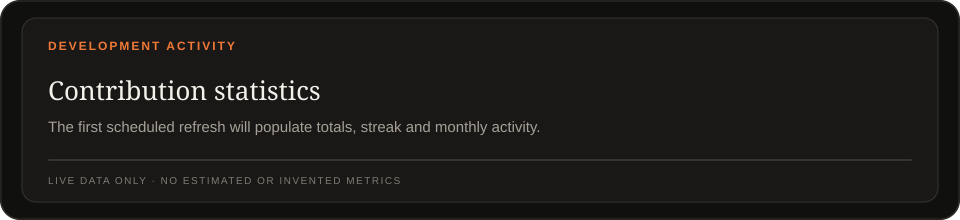
  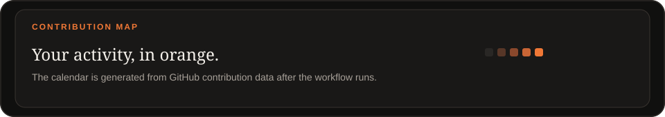

### $ ls ./featured-projects

  <a href="https://github.com/16alves02/SaborGest"></a>
  <a href="https://github.com/16alves02/RunLattice"></a>
  <a href="https://github.com/16alves02/mrdr"></a>
  <a href="https://raw-app-bice.vercel.app/"></a>
  <a href="https://github.com/16alves02/hoop"></a>

<table>
  <tr>
    <td width="50%" valign="top">
      <strong><a href="https://github.com/16alves02/SaborGest">SaborGest</a></strong> 
      ACADEMIC · IN DEVELOPMENT
      
Management system for small food businesses. Combines a PHP web panel, REST API, relational database and Kotlin Android kiosk, with staff schedules, attendance and stock management.

      PHP · PDO · MySQL · Kotlin · Android · Retrofit
    </td>
    <td width="50%" valign="top">
      <strong><a href="https://github.com/16alves02/RunLattice">RunLattice</a></strong> 
      PRODUCT PROTOTYPE · IN DEVELOPMENT
      
Workflow automation prototype with authenticated workspaces, a visual builder, PostgreSQL persistence, Redis/BullMQ execution, signed webhooks and a working Discord webhook action. The worker currently supports one trigger and at most one condition.

      Next.js · TypeScript · Better Auth · PostgreSQL · Redis · BullMQ
    </td>
  </tr>
  <tr>
    <td width="50%" valign="top">
      <strong><a href="https://github.com/16alves02/mrdr">MRDR.</a></strong> 
      ORIGINAL GAME
      
Original crime-deduction game built around procedural cases, connected clues, unique-solution validation and campaign progression.

      React · TypeScript · Zustand · Vitest · Capacitor
    </td>
    <td width="50%" valign="top">
      <strong><a href="https://github.com/16alves02/hoop">HOOP</a></strong> 
      ACADEMIC · FRONTEND
      
Basketball-store frontend with product discovery, search, filters, favourites, cart and simulated checkout. No real authentication or payments.

      React · TypeScript · Vite
    </td>
  </tr>
</table>

### $ ls ./other-work

- **RAW.** - social card app with three modes and six languages. [Public demo](https://alv16studios.itch.io/raw-conversation-game) · [Web demo](https://raw-app-bice.vercel.app). Source repository is private.
- **[Basket Hub](https://github.com/bmgoliveira-UA/basket-hub)** - academic team project for basketball operations, built with Kotlin, Ktor, Thymeleaf and Exposed.
- **[Tocadiscos Editora](https://github.com/13alves05/tocadiscos-editora)** - four-person academic Python CLI for music catalogue management, search, financial reports and reversible history.

### $ cat ./toolbox.txt

  

### $ experience --relevant

- **Backend Development Intern** - ClickBeauty / Alvocromático · PHP, MySQL and internal web systems.
- **Web Development Intern** - Associação Estamos Juntos (AEJ) · HTML, CSS, JavaScript, PHP and database integration.

Additional experience in CNC machine operation and retail, including production quality control, operational procedures and teamwork.

---

  <code>build → learn → refine</code> 
  16alves02 · Oliveira de Azeméis, Portugal

