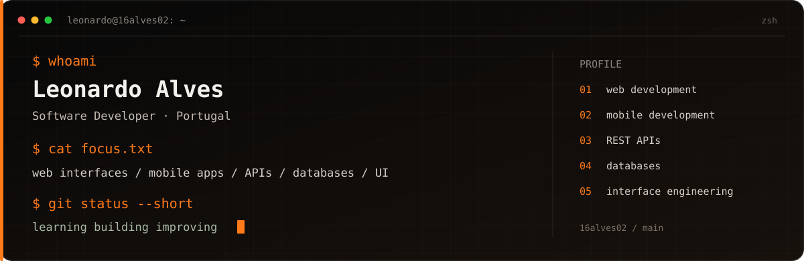

<!-- 16alves02 | GitHub profile -->

  

  <a href="https://16alves02-com.vercel.app/">Portfolio</a> ·
  <a href="https://www.linkedin.com/in/16alves02/">LinkedIn</a> ·
  <a href="mailto:16alves02@gmail.com">Email</a>

---

## About me

I'm **Leonardo Alves**, a Software Development student at **Escola Superior Aveiro Norte (ESAN), Universidade de Aveiro**, currently completing a CTeSP programme (2025–2027).

My long-term goal is to become a **Software Engineer**: someone who can understand a problem, reason about the system behind it and contribute to building reliable software across its different layers. I am developing that foundation through academic and personal projects covering web applications, backend logic, APIs, relational databases, background processing, testing and mobile development.

I enjoy exploring how the pieces of an application fit together: requirements, architecture, data, interfaces, validation and the behaviour of the complete system. I am looking to join a development team where I can contribute to real products, learn from experienced engineers and keep growing through practical work and feedback.

### Internship availability

I'm seeking a **paid curricular software development internship of 680 hours, starting in February 2027**, preferably in **Coimbra, Portugal**.

- **Start:** February 2027
- **Duration:** 680 hours
- **Preferred location:** Coimbra, Portugal
- **Work arrangement:** On-site / hybrid / remote
- **Type:** Paid curricular internship

[Portfolio](https://16alves02-com.vercel.app/) · [English CV](https://16alves02-com.vercel.app/cv-leonardo-alves-en.pdf) · [Portuguese CV](https://16alves02-com.vercel.app/cv-leonardo-alves-pt.pdf)

## Featured software projects

The order below matches the four main projects on my portfolio.

| Project | Engineering focus | Technologies | Current status |
| --- | --- | --- | --- |
| **SaborGest** | Integrated management system with a PHP web panel, REST API, relational database and Kotlin Android kiosk. Its scope includes employee schedules, attendance, stock and communication between the web and mobile clients. | PHP 8.3, PDO, REST API, MySQL/MariaDB, Kotlin, Android, Retrofit | Academic project in development; integration, acceptance and security validation remain. Not production-ready. |
| **RunLattice** | Workflow automation prototype exploring a visual editor, workflow graph validation, API operations, PostgreSQL persistence, execution history and asynchronous processing. | Next.js, React, TypeScript, Route Handlers, Zod, PostgreSQL, Prisma, Redis, BullMQ, Vitest | Prototype in development. The worker simulates workflow traversal; external integrations, authentication and workspace isolation are not implemented. |
| **MRDR.** | Original deduction game exploring case generation and validation, a modular logic engine, cross-referenced clues, campaign progression, achievements and automated tests. | React 19, TypeScript, Vite, Zustand, Vitest, Capacitor | In development. The project documentation describes a 200-case campaign and automated checks for case validity and unique solutions. |
| **RAW.** | Interactive conversation and party-game application with multiple modes, card interactions, swipe gestures, animated transitions, localisation and a mobile/PWA-oriented experience. | React, JavaScript, Tailwind CSS, Framer Motion | Live interactive project; source repository is private. |

## Additional projects

| Project | Description | Status / links |
| --- | --- | --- |
| **Nova Imagem by Maura Pereira** | Client website project for a local hair salon. The site structure and content workflow are being prepared with the owner. A CMS-based editing workflow is planned, but not yet implemented or validated. | In preparation; no finished public launch is claimed. |
| **HOOP** | Academic frontend project: a fictional basketball-store experience with product discovery, filters, product pages, favourites, a cart and a simulated checkout. It does not process real purchases. | [Repository](https://github.com/16alves02/hoop) · [Live demo](https://hoop-16alves02.netlify.app) |
| **Todo App** | Browser-based task manager with task completion, filters and local persistence. | [Repository](https://github.com/16alves02/todo-app) · [Live demo](https://todo-app-three-beta-56.vercel.app) |
| **ArraySorting** | C console program demonstrating Selection Sort, Insertion Sort, Bubble Sort and a small Bogo Sort example. | [Repository](https://github.com/16alves02/ArraySorting) |
| **Basket Hub** | Academic group project for basketball management, with modules for teams, players, games, events, registrations, organisers, venues, sponsors, rankings and statistics. | Kotlin, Ktor, Thymeleaf, Exposed, H2, Gradle · [Group repository](https://github.com/bmgoliveira-UA/basket-hub) |
| **Tocadiscos Editora** | Python command-line application for managing a fictional music publisher's catalogue, royalties, search, audio playback and change history. Academic group project; Leonardo Alves and Bruno Oliveira were the main contributors. | Python, pandas, Whoosh, Pygame, CSV · [Group repository](https://github.com/13alves05/tocadiscos-editora) |
| **Two of Hearts** | Vector playing-card illustration inspired by the traditional Lenços de Namorados of Minho, Portugal. | [Repository and artwork](https://github.com/16alves02/two-of-hearts-portuguese-folk-art) |

## Technical foundation

These are technologies I can connect to coursework, previous software internships or the projects above. My depth of experience varies by tool; I distinguish technologies used in projects from areas I am still developing.

| Area | Demonstrated technologies |
| --- | --- |
| **Languages** | JavaScript, TypeScript, PHP, Kotlin, C |
| **Frontend** | React, Next.js, Vite, React Router, HTML5, CSS3, Tailwind CSS, Framer Motion |
| **Backend and APIs** | PHP, PDO, REST APIs, Next.js Route Handlers, Zod |
| **Data and persistence** | SQL, MySQL, MariaDB, PostgreSQL, Prisma |
| **Background processing** | Redis, BullMQ |
| **Mobile** | Kotlin, Android, Capacitor |
| **Testing and tools** | Vitest, Git, GitHub, Docker Compose |

Node.js is used as the runtime environment for the Next.js project; I do not present it as a separate production backend project.

### Areas I want to deepen

Software architecture, API design, full-stack system design, data modelling, asynchronous processing, automated testing, maintainability and code quality.

## Software development experience

| Role | Organisation | Period | Focus |
| --- | --- | --- | --- |
| **Backend Development Intern** | ClickBeauty / Alvocromático | Apr–Jul 2023 | PHP, MySQL, backend functionality, internal web systems and code maintenance. |
| **Web Development Intern** | Associação Estamos Juntos (AEJ) | Jul 2022 | HTML, CSS, JavaScript, PHP and database integration for registration workflows. |

### Additional professional experience

CNC Machine Operator — Schmidt Light Metal Group · Feb 2025–May 2026  
Store Operator — MC · May–Aug 2024

## Education

- **CTeSP in Software Development** — Escola Superior Aveiro Norte, Universidade de Aveiro · 2025–2027 · In progress
- **Professional Course in IT Systems Management and Programming** — Escola Secundária Dr. Serafim Leite · 2020–2023

## Contact

I'm interested in joining a software development team where I can contribute to real systems, learn from experienced engineers and build a strong foundation for a long-term career in software engineering.

- **Email:** [16alves02@gmail.com](mailto:16alves02@gmail.com)
- **Portfolio:** [16alves02-com.vercel.app](https://16alves02-com.vercel.app/)
- **GitHub:** [github.com/16alves02](https://github.com/16alves02)
- **LinkedIn:** [linkedin.com/in/16alves02](https://www.linkedin.com/in/16alves02/)
