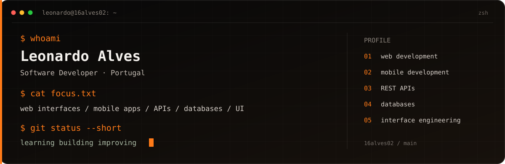

> **Idioma / Language:** [English](README.md) · [Português (Portugal)](README.pt-PT.md)

  

  

# Leonardo Alves

Desenvolvo aplicações web, APIs REST e aplicações Android. Dou importância a modelos de dados claros, decisões técnicas fundamentadas e software fácil de manter. Cada projeto indica o seu estado real e se o respetivo código-fonte é público. Os estudos de caso estão disponíveis no portefólio.

## Em resumo

| | |
| --- | --- |
| **Áreas de interesse** | Aplicações web, APIs REST, bases de dados relacionais e Android |
| **Formação atual** | CTeSP em Desenvolvimento de Software, ESAN, Universidade de Aveiro (2025–2027) |
| **Tecnologias principais** | PHP, Kotlin, TypeScript, React, MySQL e PostgreSQL |
| **Atualmente** | A desenvolver o RunLattice, a preparar o lançamento do MRDR. e a desenvolver o SaborGest |
| **Localização** | Aveiro, Portugal |

## Projetos em destaque

| Projeto | Descrição | Tecnologias | Estado |
| --- | --- | --- | --- |
| **SaborGest** · [estudo de caso](https://16alves02.pages.dev/projects/saborgest.html) | Sistema de gestão para pequenos negócios de restauração: painel web em PHP, API REST e quiosque Android em Kotlin. Inclui colaboradores, horários, assiduidade, relatórios e stock. | PHP, MySQL, Kotlin, Retrofit | Projeto académico, em desenvolvimento. Código-fonte privado |
| **RunLattice** · [repositório](https://github.com/16alves02/RunLattice) · [estudo de caso](https://16alves02.pages.dev/projects/runlattice.html) | Protótipo de automação de fluxos de trabalho: espaços autenticados, editor visual, modelos, execução com Redis/BullMQ, webhooks assinados e tarefas agendadas. Inclui uma ação externa ativa (Discord), um trigger e, no máximo, uma condição por fluxo. O planeamento por IA produz apenas rascunhos sujeitos a revisão. | Next.js, React, TypeScript, PostgreSQL, Prisma, Redis, BullMQ | Protótipo pessoal em desenvolvimento. Código público (MIT) |
| **RAW.** · [versão web](https://raw-app-bice.vercel.app) · [itch.io](https://alv16studios.itch.io/raw-conversation-game) | Jogo social de cartas com três modos, 27 baralhos, seis idiomas e uma PWA preparada para utilização offline. | React, JavaScript, PWA | Demonstração web pública. Código-fonte privado |
| **MRDR.** · [estudo de caso](https://16alves02.pages.dev/projects/mrdr.html) | Jogo original de dedução criminal baseado em provas, suspeitos, álibis e pistas relacionadas. | React, TypeScript, Vite, Capacitor | Versão funcional concluída; lançamento público pendente. Código-fonte privado |

## Outros projetos

| Projeto | Descrição | Tecnologias |
| --- | --- | --- |
| **[HOOP](https://github.com/16alves02/hoop)** · [demonstração](https://hoop-16alves02.netlify.app) | Projeto académico: frontend de uma loja de basquetebol com pesquisa, filtros, favoritos, carrinho e checkout simulado (sem pagamentos reais). | React, TypeScript, Vite |
| **[Basket Hub](https://github.com/bmgoliveira-UA/basket-hub)** | Projeto académico de grupo para gestão de basquetebol. Repositório de referência mantido pelo grupo. | Kotlin, Ktor, Thymeleaf, Exposed |
| **[Tocadiscos Editora](https://github.com/13alves05/tocadiscos-editora)** | Projeto académico de equipa (quatro elementos): aplicação de linha de comandos para artistas, álbuns e faixas, com pesquisa, relatórios, reprodução de áudio e histórico de alterações. | Python, Pandas, Whoosh, Pygame |
| **[Todo App](https://github.com/16alves02/todo-app)** | Gestor de tarefas no browser com filtros, armazenamento local e navegação por teclado. | HTML, CSS, JavaScript |
| **[Two of Hearts](https://github.com/16alves02/two-of-hearts-portuguese-folk-art)** | Ilustração vetorial de uma carta de jogar, inspirada nos Lenços de Namorados do Minho. | Affinity |
| **[ArraySorting](https://github.com/16alves02/ArraySorting)** | Programa de consola em C que demonstra quatro algoritmos de ordenação, desenvolvido no 12.º ano. | C |

## Ferramentas e tecnologias

A profundidade de experiência varia consoante a tecnologia e o projeto. Cada projeto indica a sua própria stack.

**Linguagens**

**Frontend e Android**

**Backend e dados**

**Ferramentas**

## Experiência

| Função | Entidade | Período |
| --- | --- | --- |
| **Estágio de Desenvolvimento Backend** (PHP, MySQL) | ClickBeauty / Alvocromático | Abr–Jul 2023 |
| **Estágio de Desenvolvimento Web** | Associação Estamos Juntos | Jul 2022 |
| Operador de máquinas CNC | Schmidt Light Metal Group | Fev 2025 – Mai 2026 |
| Operador de loja | MC | Mai–Ago 2024 |

## Formação

| Qualificação | Instituição | Período |
| --- | --- | --- |
| **CTeSP em Desenvolvimento de Software** | ESAN, Universidade de Aveiro | 2025–2027 |
| Curso Profissional de Gestão e Programação de Sistemas Informáticos | Escola Secundária Dr. Serafim Leite | 2020–2023 |

## Atividade no GitHub

  
  

  

Mais atividade

  

  

<em>construir · compreender · melhorar</em>

  

